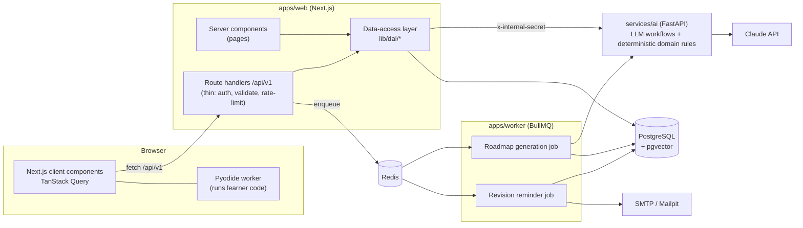
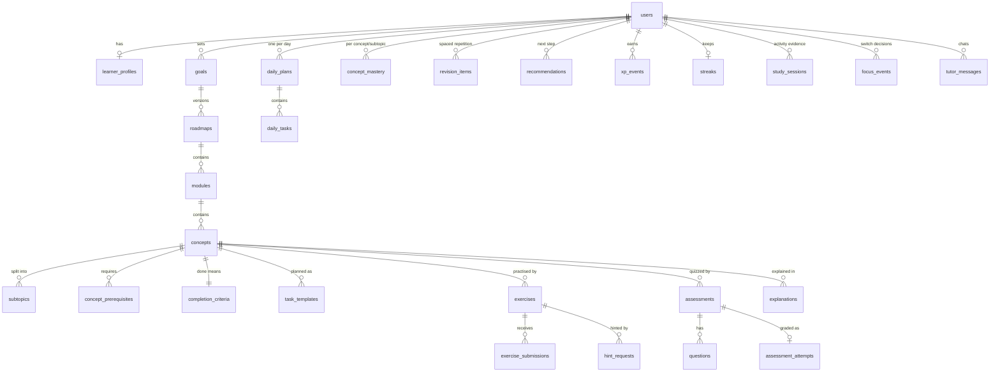

# FocusPath AI

**An AI learning coach that keeps you on one path until you've actually learned it.**

FocusPath turns a goal like _"Become an AI Engineer"_ into a personalised roadmap of modules and concepts, plans a realistic slice of it into each day, and only counts a concept as learned when there's **evidence**: a passed quiz, solved coding exercises and an explanation in your own words. An AI tutor that knows your roadmap, level and weak spots sits beside you in Focus mode, and spaced-repetition revisions bring concepts back before you forget them.

---

## Table of contents

1. [Features](#features)
2. [Product rules](#product-rules)
3. [Tech stack](#tech-stack)
4. [System architecture](#system-architecture)
5. [Repository layout](#repository-layout)
6. [Web app architecture (layers)](#web-app-architecture-layers)
7. [Engineering principles: SOLID, modularity and reuse](#engineering-principles-solid-modularity-and-reuse)
8. [Domain model](#domain-model)
9. [Key flows](#key-flows)
10. [Getting started](#getting-started)
11. [Configuration](#configuration)
12. [Scripts](#scripts)
13. [Testing](#testing)
14. [HTTP API reference](#http-api-reference)
15. [Extending the system](#extending-the-system)
16. [Security notes](#security-notes)
17. [Troubleshooting](#troubleshooting)

---

## Features

| Area                                  | What the learner gets                                                                                                                                                                                                                                       |
| ------------------------------------- | ----------------------------------------------------------------------------------------------------------------------------------------------------------------------------------------------------------------------------------------------------------- |
| **Onboarding → Roadmap**              | Goal, level, prior knowledge, daily time and target months become an AI-generated roadmap (modules → concepts → subtopics), with prerequisites, completion criteria and task templates. Generation runs in a background job; the UI polls until it's ready. |
| **Today dashboard**                   | Today's focus concept and its tasks, scaled to the learner's daily minutes, plus streak, XP/level, a weekly study-time chart, weekly stats and the next recommended step with its reason.                                                                   |
| **Focus mode**                        | One concept at a time: objective, AI-generated Python exercises that run **in the browser** (Pyodide), a 25-minute study timer, an "explain it in your own words" box and an AI tutor with progressive hints.                                               |
| **Focus guard**                       | "Switch topic" doesn't block anything. It shows the trade-off ("you're 2 tasks from finishing…"), offers help from the tutor, and logs the choice.                                                                                                          |
| **Quizzes & results**                 | AI-generated multiple-choice quizzes graded **on the server**, a per-subtopic mastery breakdown, the three kinds of evidence side by side, a question review and the next recommendation.                                                                   |
| **Mastery**                           | A deterministic, versioned mastery estimate (`rule-v1`) built from quiz, practical and explanation evidence. No concept can pass on one kind of evidence alone.                                                                                             |
| **Spaced repetition**                 | Revision items on a 1 / 3 / 7 / 14 / 30-day ladder (weak subtopics come back sooner), email reminders, and short recall quizzes.                                                                                                                            |
| **Gamification that can't be farmed** | XP only for real evidence, and each piece of evidence pays once. Streaks count days with evidence, not days the app was opened.                                                                                                                             |
| **Auth**                              | Email + password (with reset by email) and optional Google OAuth, via Better Auth.                                                                                                                                                                          |

## Product rules

These rules shape the code; comments reference them as _"product rule N"_.

- **Evidence kinds stay separate** (rule 1): _activity_ (study time, reading), _knowledge_ (quizzes, explanations) and _practical_ (solved exercises). A task's evidence kind is derived from its task kind and never chosen freely; only activity tasks can be ticked by hand.
- **Mastery is an estimate from evidence** (rule 2): `score = 100 × (0.4·quiz + 0.4·practical + 0.2·explanation)`, recency-weighted with a 14-day half-life, pass mark 70. Mirrored in `packages/shared/src/enums.ts` and `services/ai/app/domain/mastery.py`.
- **Every recommendation explains itself** (rule 4): the "why" is a required field.
- **Focus mode guides, never punishes** (rule 5): switching topics is always allowed; it is made conscious and logged.
- **The tutor knows the learner** (rule 6): goal, level, current concept, weak subtopics and recent mistakes are sent with every tutor/hint request.
- **XP only for meaningful evidence** (rule 7): idempotent awards keyed by source, e.g. `exercise:<id>`, so nothing pays twice.
- **One active goal at a time**: starting a new goal archives the old one.

## Tech stack

| Layer           | Technology                                                                              |
| --------------- | --------------------------------------------------------------------------------------- |
| Monorepo        | pnpm workspaces + Turborepo                                                             |
| Web app         | Next.js 16 (App Router, route handlers, `proxy.ts`), React 19, TypeScript 6             |
| UI              | Tailwind CSS 4, Radix UI primitives, `class-variance-authority`, Recharts, CodeMirror 6 |
| Client data     | TanStack Query 5                                                                        |
| Validation      | Zod 4 (TypeScript), Pydantic 2 (Python)                                                 |
| Auth            | Better Auth (email/password, Google OAuth), sessions in Postgres                        |
| Database        | PostgreSQL 17 + pgvector, Drizzle ORM + drizzle-kit migrations                          |
| Jobs            | BullMQ on Redis (roadmap generation, revision reminders)                                |
| Rate limiting   | Redis fixed-window counter (atomic Lua script)                                          |
| AI service      | Python 3.12, FastAPI, Anthropic SDK (structured outputs), uv                            |
| In-browser code | Pyodide in a Web Worker, with a per-run timeout                                         |
| Mail            | Nodemailer; Mailpit in development                                                      |
| Testing         | Vitest, pytest, Playwright                                                              |
| Quality         | ESLint (typescript-eslint), Prettier, ruff, mypy `--strict`                             |

## System architecture



**Responsibilities by deployable:**

- **`apps/web`** owns every user-facing request: authentication, authorization (ownership checks), persistence and orchestration. It is the only component the browser talks to.
- **`services/ai`** is a stateless, internal-only service. It owns (a) LLM workflows: roadmap, quiz, exercise, hint, tutor and explanation-grading prompts, with validation and retries, and (b) deterministic domain rules: mastery calculation, revision scheduling and the recommender. It never touches the database, and every `/v1` route requires a shared secret.
- **`apps/worker`** runs slow or periodic work outside the request cycle: roadmap generation (minutes of LLM time, retried with backoff) and the every-15-minutes reminder scan.
- **`packages/shared`** holds the contracts all TypeScript code agrees on: enums, Zod schemas for API input and AI responses, the typed AI client and pure business rules (XP, streaks, statuses, planning, hints, topic matching).
- **`packages/db`** holds the Drizzle schema, migrations, the `createDb` factory and the roadmap persistence repository used by the worker.

## Repository layout

```text
focuspath/
├── apps/
│   ├── web/                         Next.js app (UI + /api/v1 + DAL)
│   │   ├── e2e/                     Playwright journeys (run against AI_MODE=fake)
│   │   ├── public/pyodide-worker.js Web Worker that runs learner Python
│   │   └── src/
│   │       ├── app/                 App Router: (auth), (app), (focus), onboarding, api/
│   │       ├── components/
│   │       │   ├── ui/              Design-system primitives (Button, Card, Dialog, Field…)
│   │       │   ├── focus/           Focus-mode feature components
│   │       │   │   ├── hooks/       use-exercises, use-code-runner, use-code-draft,
│   │       │   │   │                use-tutor-chat, use-countdown, use-study-session, use-study-timer
│   │       │   │   └── tutor/       ChatMessage, HintBox
│   │       │   └── status.tsx       Status badges/dots, evidence tags
│   │       └── lib/
│   │           ├── api/             Browser API layer: client, endpoints, query-keys, contracts
│   │           ├── dal/             Server data-access layer (one module per responsibility)
│   │           ├── pyodide/         CodeRunner interface + PythonRunner implementation
│   │           ├── errors.ts        Transport-free application errors (AppError, notFound…)
│   │           ├── http.ts          route() wrapper, error → response mapping, parseBody, rateLimit
│   │           ├── page-data.ts     loadByIdOr404 for server pages
│   │           ├── routes.ts        Typed in-app page paths
│   │           └── auth.ts, db.ts, ai.ts, redis.ts, queue.ts, env.ts, …  (singletons / config)
│   └── worker/
│       └── src/
│           ├── main.ts              Composition root
│           ├── config.ts            Typed, validated configuration
│           ├── queues.ts            Queue/worker registration (dependencies injected)
│           ├── health.ts            Liveness endpoint
│           ├── mailer.ts            Mailer interface + Nodemailer implementation
│           └── jobs/                roadmap.ts, reminders.ts
├── packages/
│   ├── config/                      Shared tsconfig + ESLint config
│   ├── db/                          Drizzle schema, migrations, createDb, repo/roadmap.ts
│   └── shared/                      Enums, Zod contracts, AI client, pure rules (+ tests)
├── services/
│   └── ai/                          FastAPI service
│       ├── app/
│       │   ├── main.py              Routes + dependency wiring + error mapping
│       │   ├── service.py           LLM workflows (Task specs, generate/check/retry)
│       │   ├── llm.py               LLM protocol, AnthropicLLM, FakeLLM
│       │   ├── prompts.py           Versioned prompts
│       │   ├── schemas.py           Pydantic contracts (source of truth, camelCase on the wire)
│       │   ├── errors.py            ServiceError hierarchy
│       │   ├── fakes.py             Deterministic fixtures for AI_MODE=fake
│       │   └── domain/              mastery, scheduler, recommender, validation, exercise_check
│       └── tests/
├── docker/postgres-init.sql         pgvector + test database
├── docker-compose.yml               Postgres, Redis, Mailpit
└── turbo.json                       Task graph (build, dev, lint, typecheck, test)
```

## Web app architecture (layers)

The web app follows a strict layered architecture. Each layer depends only on the one below it.

```text
┌──────────────────────────────────────────────────────────────────────────────┐
│ Presentation (client)   app/**/*-screen.tsx, components/**                     │
│   Screens compose feature components; feature hooks own data fetching.        │
│   Depends on: lib/api (endpoints, queryKeys, contracts), lib/routes            │
├──────────────────────────────────────────────────────────────────────────────┤
│ Browser API layer       lib/api/                                               │
│   client.ts     transport (JSON, errors, 401 → /login)                         │
│   endpoints.ts  one typed function per endpoint, grouped by resource           │
│   query-keys.ts React Query cache keys (single source)                         │
│   contracts.ts  type-only view models re-exported from the DAL                 │
├──────────────────────────────────────────────────────────────────────────────┤
│ Transport (server)      app/api/v1/**/route.ts, app/**/page.tsx                │
│   route() resolves the session, handlers parse input (Zod), rate-limit,        │
│   call one DAL function and return a plain object. No SQL here.                │
├──────────────────────────────────────────────────────────────────────────────┤
│ Data-access layer       lib/dal/*                                              │
│   Authorization (ownership.ts), persistence, orchestration, view models.       │
│   Throws AppError (lib/errors.ts) and knows nothing about HTTP.                │
├──────────────────────────────────────────────────────────────────────────────┤
│ Infrastructure          lib/db.ts, lib/ai.ts, lib/redis.ts, lib/queue.ts,      │
│                         @focuspath/db, @focuspath/shared/ai-client             │
└──────────────────────────────────────────────────────────────────────────────┘
```

### DAL modules (one responsibility each)

| Module               | Responsibility                                                                                                                                                     |
| -------------------- | ------------------------------------------------------------------------------------------------------------------------------------------------------------------ |
| `ownership.ts`       | **All** authorization guards: `ownedConcept`, `ownedExercise`, `ownedAssessment`. Another learner's id resolves to 404.                                            |
| `concept.ts`         | Shared concept reads: `getSubtopics`, `SubtopicIndex` (id ↔ key), `getCompletionCriteria` (with defaults), `toConceptContext` / `getConceptContext` (AI contract). |
| `learner-context.ts` | `buildLearnerContext`: what the AI knows about the learner (goal, level, weak areas, recent mistakes).                                                             |
| `profile.ts`         | Profile, active goal, onboarding, roadmap versioning, `requireProfile`, `getLearnerSettings`, `updateProfile`.                                                     |
| `roadmap.ts`         | Roadmap tree with derived concept statuses, roadmap view, concept detail.                                                                                          |
| `plan.ts`            | Daily plans and tasks, evidence-driven task completion, study sessions, the Today view.                                                                            |
| `exercises.ts`       | Exercise generation/listing, submissions (server-side "solved" rule), progressive hints.                                                                           |
| `tutor.ts`           | Tutor chat history and replies.                                                                                                                                    |
| `explanations.ts`    | "Explain it" evaluation → evidence, XP, mastery.                                                                                                                   |
| `assessment.ts`      | Quiz generation, server-side grading, results view, recall quizzes.                                                                                                |
| `mastery.ts`         | Gather evidence → ask the AI service for the score → upsert concept and subtopic mastery.                                                                          |
| `revisions.ts`       | Revision schedule persistence, due list, `ownedRevision`.                                                                                                          |
| `recommendations.ts` | Next-step recommendation lifecycle + `toRecommendationView`.                                                                                                       |
| `focus-guard.ts`     | Switch-topic check and focus-event logging.                                                                                                                        |
| `engagement.ts`      | Idempotent XP awards, streak updates, totals.                                                                                                                      |

## Engineering principles: SOLID, modularity and reuse

### Single Responsibility (SRP)

- **DAL split by responsibility.** The former `practice.ts` (exercises, hints, tutor, explanations and focus guard) became `exercises.ts`, `tutor.ts`, `explanations.ts` and `focus-guard.ts`. The former `mastery.ts` (mastery, scheduling and recommendations) became `mastery.ts`, `revisions.ts` and `recommendations.ts`.
- **Thin route handlers.** A handler parses input, applies a rate limit and calls one DAL function. Session resolution, JSON serialisation and error mapping live in the `route()` wrapper (`lib/http.ts`). For example, `/api/v1/profile` no longer writes to the database itself; it calls `updateProfile`.
- **UI components do one thing.** `FocusScreen` composes `FocusHeader`, `ExerciseTabs`, `ExercisePanel`, `ExplanationBox`, `TutorPanel` and `SwitchTopicDialog`. `TutorPanel` composes `ChatMessage` and `HintBox`; `ExercisePanel` composes `TestOutput`.
- **Hooks separate concerns.** The study timer is a pure countdown (`useCountdown`) plus server-session syncing (`useStudySession`), composed by `useStudyTimer`. Code execution (`useCodeRunner`), local drafts (`useCodeDraft`) and server state (`useExercises`, `useSubmitExercise`, `useRequestHint`, `useTutorChat`) are each their own hook.
- **Worker composition.** `main.ts` only wires dependencies. Config (`config.ts`), queue registration (`queues.ts`) and liveness (`health.ts`) are separate modules.

### Open/Closed (OCP)

- **AI workflows are data-driven.** `services/ai/app/service.py` describes each model task as a `Task` spec (prompt, effort, token budget). The call → validate → retry-with-feedback loop (`_generate_checked`) is written once, so a new task is a new spec plus a `check` function, with no change to the plumbing.
- **Errors map in one place.** The DAL throws `AppError` subclasses via factories (`notFound`, `conflict`, `tooManyRequests`, …). `errorResponse` maps them, `ZodError` and `AiServiceError` to HTTP. New error kinds need no handler changes. The Python service does the same with `ServiceError` and a FastAPI exception handler.
- **Scheduler and LLM are swappable.** Both are `Protocol`s in the AI service (`Scheduler`, `LLM`), so FSRS or another model can replace the current implementations without touching callers.

### Liskov Substitution (LSP)

- `FakeLLM` and `AnthropicLLM` both satisfy the `LLM` protocol and return the same validated Pydantic models, so the entire stack (and the E2E suite) runs unchanged in `AI_MODE=fake`.
- Any `CodeRunner` (`PythonRunner` today) can be passed to `useCodeRunner`.
- `DbExecutor = Database | Transaction`: functions like `awardXp`, `recordEvidenceDay` and `completeTasksByEvidence` behave identically whether given the pool or an open transaction, so they compose into a caller's transaction.

### Interface Segregation (ISP)

- `@focuspath/shared` exposes narrow entry points: `@focuspath/shared` (contracts and rules, safe anywhere) and `@focuspath/shared/ai-client` (server-only). `@focuspath/db` similarly exposes `.`, `./schema` and `./roadmap`.
- `Mailer` exposes only `sendRevisionReminder`; `CodeRunner` only `warmUp`, `run` and `dispose`; `JobDeps` lists exactly what job handlers need.
- Client components import small view types (`ExerciseView`, `TodayView`, …) from `lib/api/contracts.ts`, never whole server modules.

### Dependency Inversion (DIP)

- **The DAL doesn't depend on the transport.** It throws `AppError` from `lib/errors.ts`, which has no Next.js, auth or HTTP imports. Only `lib/http.ts` and `lib/page-data.ts` translate errors for their transport.
- **The AI service domain doesn't depend on FastAPI.** `service.py` raises `ServiceError`; `main.py` maps it to HTTP.
- **UI depends on abstractions.** Components call `endpoints.*` and `queryKeys.*` rather than building URLs and cache keys, and `useCodeRunner` depends on the `CodeRunner` interface, injected with a factory.
- **Worker uses a composition root.** `main.ts` builds `db`, `ai`, `mailer` and `connection` once and injects them (`JobDeps`) into the queue workers; no handler constructs its own clients.
- **Infrastructure behind accessors.** The web app reaches Postgres, Redis, the AI service and Better Auth through lazy, process-wide accessors (`db()`, `redis()`, `ai()`, `auth()`), which survive dev hot reloads and keep construction in one place.

### DRY and reuse

| Previously duplicated                                         | Now                                             |
| ------------------------------------------------------------- | ----------------------------------------------- |
| Subtopic `key ↔ id` maps rebuilt in 5 places                  | `SubtopicIndex` (`dal/concept.ts`)              |
| `criteria?.exercisesRequired ?? 3`, `?? MASTERY.passMark`     | `getCompletionCriteria()` + `DEFAULTS`          |
| `profile?.timezone ?? "UTC"`, `profile?.level ?? "beginner"`  | `getLearnerSettings()`                          |
| Magic `< 3` for "used the answer hint"                        | `usedAnswerHint()` (shared rule, unit-tested)   |
| "First solve per exercise" loops                              | `firstPerKey()` (shared rule, unit-tested)      |
| Recommendation serialised field-by-field twice                | `toRecommendationView()`                        |
| `type Tx = Parameters<…>` declared in two modules             | `Transaction` / `DbExecutor` in `@focuspath/db` |
| UUID check + 404 try/catch in 3 pages                         | `loadByIdOr404()`                               |
| URL strings and `["exercises", id]` keys across 12 components | `endpoints`, `queryKeys`, `paths`               |
| Repeated card markup                                          | `components/ui/card.tsx`                        |
| Python try/except + retry loop ×6                             | `_generate` / `_generate_checked`               |

### Other conventions

- **Validate at every boundary.** Zod parses request bodies and **re-validates every AI response**; Pydantic validates on the AI-service side; route ids must be UUIDs (`uuidParam`).
- **Stable keys, not ids, across services.** AI contracts speak in kebab-case keys (`functions`, `return-values`), so content and progress survive roadmap regeneration.
- **Pure rules are shared and tested.** XP, levels, streaks, concept statuses, task planning, dates, hints and topic matching live in `packages/shared/src/rules` with Vitest tests.
- **Versioned algorithms.** Mastery (`calcVersion`), the scheduler (`schedulerVersion`) and prompts (`promptVersion`) are stored with their outputs.
- **Idempotency.** XP events are unique per `(source, sourceId)`; roadmap jobs use `jobId = roadmapId` and skip already-finished work.

## Domain model



Auth tables (`users`, `sessions`, `accounts`, `verifications`) are managed through Better Auth's Drizzle adapter. Achievements tables (`achievements`, `user_achievements`) are present in the schema.

## Key flows

### Onboarding → roadmap

1. `POST /api/v1/onboarding` saves the profile, archives any active goal, creates the goal and roadmap v1 in `generating` state (one transaction), then enqueues a BullMQ job.
2. The worker calls `services/ai /v1/roadmaps/generate`. The AI service validates the draft beyond its schema (prerequisite graph, time budget, …) and retries once with the problems as feedback.
3. The worker re-validates the response with Zod and `saveRoadmapDraft` persists it. It supersedes the previous version and **carries mastery and pending revisions across by concept/subtopic key**.
4. The browser polls `/api/v1/roadmaps/:id/status` and moves to `/roadmap` when it's ready. After the final retry a failure is stored on the roadmap and shown with a retry button.

### Solving an exercise

1. The learner's code runs in a Pyodide Web Worker against the exercise's tests (8 s timeout per run, so an infinite loop kills only the worker).
2. `POST /api/v1/exercises/:id/submissions` records the result. **"Solved" is decided on the server**: every stored test must be reported as passed. Hint usage is read from `hint_requests`, never trusted from the client.
3. In one transaction: insert the submission and award XP (once per exercise; less if the answer hint was used). Then: complete coding/mini-project tasks whose criteria are met, and recompute mastery.

### Quiz → mastery → revisions → recommendation

`submitAttempt` grades on the server (overall and per subtopic), records the attempt and completes the assessment task, awards XP on the first pass, and closes due revisions if it was a recall quiz. It then runs `recomputeMastery` → `rescheduleRevisions` → `refreshRecommendation`. Each of those three steps gathers state in the DAL and delegates the decision to a deterministic rule in `services/ai/app/domain`.

## Getting started

### Prerequisites

- **Node.js ≥ 22.12** and **pnpm 12** (`corepack enable` or Volta)
- **Python 3.12** and **[uv](https://docs.astral.sh/uv/)**
- **Docker** (for Postgres, Redis and Mailpit)
- An **Anthropic API key** for live AI. Without one, run with `AI_MODE=fake`.

### Setup

Run these from the **repository root**. The `pnpm` scripts (`db:migrate`, `dev`, …) are defined in the root `package.json`; from a subfolder such as `apps/web` pnpm reports `Command "db:migrate" not found`. To run one from any folder, add the workspace flag: `pnpm -w db:migrate`.

```bash
# 1. Install dependencies
pnpm install
(cd services/ai && uv sync)

# 2. Configure environment
cp .env.example .env
#    then set BETTER_AUTH_SECRET (openssl rand -base64 32), AI_SERVICE_SECRET,
#    and ANTHROPIC_API_KEY (or AI_MODE=fake)

# 3. Start infrastructure (Postgres on host port 5433, Redis 6379, Mailpit 1025/8025)
docker compose up -d

# 4. Create the schema
pnpm db:migrate

# 5. Run everything (web :3000, worker, AI service :8000)
pnpm dev
```

Open <http://localhost:3000>, sign up, and complete onboarding. Password-reset and reminder emails arrive in Mailpit at <http://localhost:8025>.

| Service                   | URL                        |
| ------------------------- | -------------------------- |
| Web app                   | http://localhost:3000      |
| AI service (OpenAPI docs) | http://localhost:8000/docs |
| Worker health             | http://localhost:8001      |
| Mailpit                   | http://localhost:8025      |

## Configuration

All apps read the single **root `.env`** (see `.env.example`). The web app validates its variables with Zod at first use (`apps/web/src/lib/env.ts`); the worker validates its own in `apps/worker/src/config.ts`.

| Variable                                    | Used by         | Description                                                                                       |
| ------------------------------------------- | --------------- | ------------------------------------------------------------------------------------------------- |
| `APP_URL`                                   | web, worker     | Public base URL (links in emails).                                                                |
| `DATABASE_URL`                              | web, worker, db | Postgres connection string.                                                                       |
| `TEST_DATABASE_URL`                         | e2e             | Database used by Playwright.                                                                      |
| `REDIS_URL`                                 | web, worker     | BullMQ and rate limiting.                                                                         |
| `BETTER_AUTH_SECRET`                        | web             | Session signing secret (≥ 16 chars).                                                              |
| `BETTER_AUTH_URL`                           | web             | Auth base URL.                                                                                    |
| `GOOGLE_CLIENT_ID` / `GOOGLE_CLIENT_SECRET` | web             | Optional; the Google button is hidden when unset.                                                 |
| `SMTP_HOST` / `SMTP_PORT` / `SMTP_FROM`     | web, worker     | Outgoing mail.                                                                                    |
| `AI_SERVICE_URL`                            | web, worker     | Use `127.0.0.1`, not `localhost`: Node resolves `localhost` to `::1` and uvicorn listens on IPv4. |
| `AI_SERVICE_SECRET`                         | web, worker, ai | Shared secret sent as `x-internal-secret`.                                                        |
| `ANTHROPIC_API_KEY`                         | ai              | Claude API key.                                                                                   |
| `AI_MODE`                                   | ai              | `live` or `fake` (deterministic fixtures, no key needed).                                         |
| `AI_MODEL`                                  | ai              | Model id (default `claude-opus-5-5`).                                                             |
| `DISABLE_RATE_LIMIT`                        | web             | `1` disables per-user and auth rate limits (tests).                                               |
| `WORKER_HEALTH_PORT`                        | worker          | Liveness port (default `8001`).                                                                   |

## Scripts

Run from the repository root, or from any folder with `pnpm -w <script>` (Turborepo fans out to every package):

| Command                              | What it does                                               |
| ------------------------------------ | ---------------------------------------------------------- |
| `pnpm dev`                           | Web, worker and AI service in watch mode.                  |
| `pnpm build`                         | Production build.                                          |
| `pnpm typecheck`                     | `tsc` for TS packages, `mypy --strict` for the AI service. |
| `pnpm lint`                          | ESLint, plus `ruff check` and `ruff format --check`.       |
| `pnpm test`                          | Vitest and pytest.                                         |
| `pnpm e2e`                           | Playwright end-to-end suite.                               |
| `pnpm format` / `pnpm format:check`  | Prettier.                                                  |
| `pnpm db:generate`                   | Generate a Drizzle migration from schema changes.          |
| `pnpm db:migrate`                    | Apply migrations.                                          |
| `pnpm --filter @focuspath/db studio` | Drizzle Studio.                                            |

## Testing

| Suite                   | Location                              | Covers                                                                                                                                                |
| ----------------------- | ------------------------------------- | ----------------------------------------------------------------------------------------------------------------------------------------------------- |
| Shared rules (Vitest)   | `packages/shared/src/rules/*.test.ts` | XP and levels, streaks, dates and time zones, concept statuses, task planning, hint rules, topic matching.                                            |
| Web (Vitest)            | `apps/web/src/**/*.test.ts`           | e.g. password strength.                                                                                                                               |
| Worker (Vitest)         | `apps/worker/src/*.test.ts`           | Configuration defaults, overrides and fail-fast.                                                                                                      |
| AI service (pytest)     | `services/ai/tests`                   | API auth and contracts, mastery, scheduler, recommender, roadmap validation, and the generate/check/retry plumbing (with a scripted LLM).             |
| End-to-end (Playwright) | `apps/web/e2e`                        | Full learner journeys against the test database with `AI_MODE=fake` and rate limits off. Playwright starts the AI service, worker and web app itself. |

```bash
pnpm test                    # unit tests, all packages
docker compose up -d && pnpm e2e
```

## HTTP API reference

Every `/api/v1` route requires a session cookie (401 otherwise) and scopes every query to the signed-in user. Errors are JSON: `{ "error": string, ...extra }`.

| Method & path                                        | Purpose                                                 | Rate limit       |
| ---------------------------------------------------- | ------------------------------------------------------- | ---------------- |
| `POST /onboarding`                                   | Save profile, create goal + roadmap, enqueue generation | roadmap          |
| `GET /roadmaps/:id/status`                           | Poll roadmap generation                                 | —                |
| `POST /goals/:id/roadmap/regenerate`                 | New roadmap version                                     | roadmap          |
| `GET /roadmap`                                       | Active roadmap tree with statuses                       | —                |
| `GET /concepts/:id`                                  | Concept detail                                          | —                |
| `GET, PUT /profile`                                  | Read / update learner profile                           | —                |
| `GET /today`                                         | Today dashboard view                                    | —                |
| `POST /focus`                                        | Set today's focus concept                               | —                |
| `PATCH /tasks/:id`                                   | Tick an activity task                                   | —                |
| `POST /study-sessions` · `PATCH /study-sessions/:id` | Start / sync a study session                            | —                |
| `GET /concepts/:id/exercises`                        | List (generating on first call) exercises               | generate         |
| `POST /exercises/:id/submissions`                    | Submit test results                                     | —                |
| `POST /exercises/:id/hints`                          | Next progressive hint                                   | hint             |
| `GET, POST /tutor/messages`                          | Tutor history / send a message                          | tutor (POST)     |
| `POST /explanations`                                 | Evaluate an explanation                                 | explanation      |
| `POST /concepts/:id/assessments`                     | Generate a quiz                                         | generate         |
| `GET /assessments/:id`                               | Quiz questions (no answers)                             | —                |
| `POST /assessments/:id/attempts`                     | Submit answers (graded server-side)                     | —                |
| `GET /attempts/:id/results`                          | Results view                                            | —                |
| `GET /revisions` · `POST /revisions/:id/start`       | Due revisions / start a recall quiz                     | generate (start) |
| `POST /focus-events/check` · `POST /focus-events`    | Focus guard check / log choice                          | —                |

The AI service's internal API (`/v1/roadmaps/generate`, `/v1/assessments/generate`, `/v1/exercises/generate`, `/v1/tutor/hint`, `/v1/tutor/reply`, `/v1/explanations/evaluate`, `/v1/mastery/calculate`, `/v1/revisions/schedule`, `/v1/recommendations/next`) is documented at `http://localhost:8000/docs`.

## Extending the system

**Add an API endpoint**

1. Add the input schema to `packages/shared/src/api.ts`.
2. Add a DAL function in the module that owns the responsibility, or a new module if none does. Authorize through `ownership.ts` and throw `AppError` factories from `lib/errors.ts`.
3. Add a thin handler: `export const POST = route(async ({ req, userId }) => myFn(userId, await parseBody(req, MySchema)))`.
4. Add a typed function to `lib/api/endpoints.ts`, a key to `query-keys.ts` if it's a query, and export any view type from `contracts.ts`.

**Add an AI task**

1. Add request/response models to `services/ai/app/schemas.py` and a prompt to `prompts.py`.
2. Add a `Task(...)` spec and a workflow in `service.py` using `_generate` or `_generate_checked`.
3. Add a fixture branch to `fakes.py` so `AI_MODE=fake` and E2E keep working.
4. Mirror the contract in `packages/shared/src/ai.ts` and add a method to `ai-client.ts`.

**Add a UI feature**

Put primitives in `components/ui`, feature components in `components/<feature>/` with data hooks in `components/<feature>/hooks/`, and keep screens (`app/**/…-screen.tsx`) as composition only.

## Security notes

- **Authorization by construction.** Every learner-owned resource is loaded through `dal/ownership.ts` (or a user-scoped query), and foreign ids return 404.
- **Server-authoritative evidence.** Quiz grading, the "solved" rule, hint levels, XP and study time (capped at wall-clock time) are computed on the server.
- **Secrets stay server-side.** The AI client is a separate, server-only entry point. The AI service rejects calls without the shared secret (constant-time compare). Reference solutions and correct answers never reach the browser before submission.
- **Rate limits.** Per-user limits on AI-backed routes, and stricter limits on sign-in, sign-up and password reset, using an atomic Redis counter.
- **`proxy.ts`** does an optimistic cookie check for redirects only. Real session validation happens in layouts and route handlers.

## Troubleshooting

| Symptom                                                        | Fix                                                                                                 |
| -------------------------------------------------------------- | --------------------------------------------------------------------------------------------------- |
| Web can't reach the AI service (`ECONNREFUSED ::1:8000`)       | Set `AI_SERVICE_URL=http://127.0.0.1:8000`.                                                         |
| Roadmap stuck on "Building…"                                   | Is the worker running (`http://localhost:8001`)? Is Redis up? Check the worker logs.                |
| "The AI tutor is unavailable"                                  | AI service down, missing `ANTHROPIC_API_KEY`, or rate-limited upstream. Use `AI_MODE=fake` locally. |
| Port 5432 already in use                                       | Compose maps Postgres to **5433** on the host; use the URLs from `.env.example`.                    |
| `Command "db:migrate" not found`                               | You're in a subfolder. `cd` to the repo root, or run `pnpm -w db:migrate`.                          |
| `ECONNREFUSED ::1:6379` / `:5433`, or signup "Failed to fetch" | Redis/Postgres aren't running. Start Docker Desktop, then `docker compose up -d`.                   |
| Python runtime fails to load in the browser                    | Pyodide is fetched on first use; check network access.                                              |
